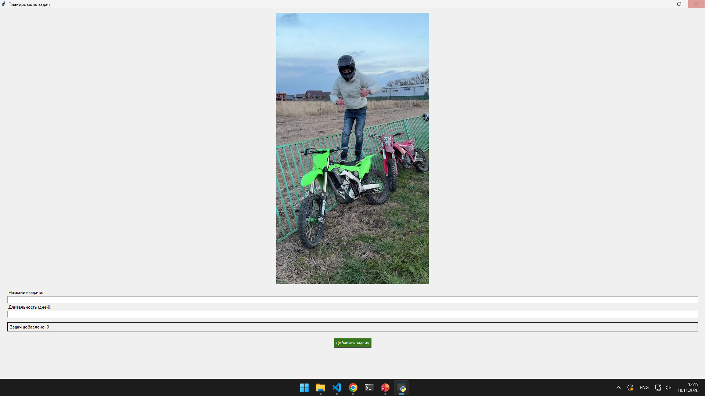
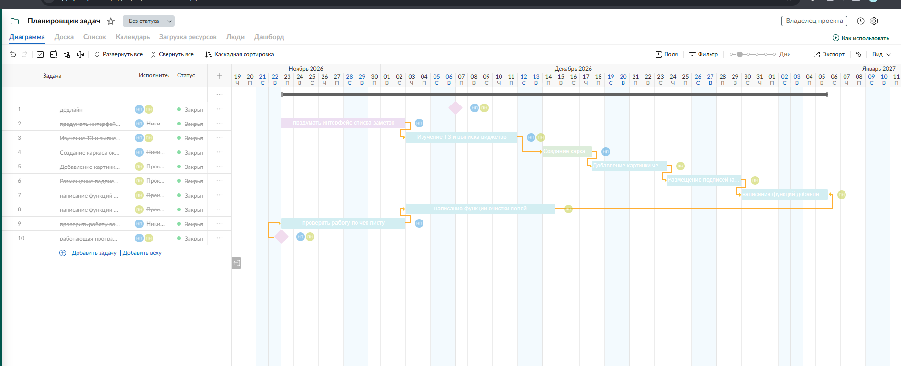

# Планировщик задач (Tkinter GUI)

Простое оконное приложение на Python с использованием библиотеки Tkinter для ведения списка задач, а также планирование его разработки по диаграмме Ганта.

## Скриншот работы программы



## Диаграмма Ганта (План и Факт)



## Функционал приложения
- Отображение тематического изображения в верхней части окна (`PhotoImage` + `Label`).
- Ввод названия задачи и её длительности в днях (`Entry`).
- Добавление задачи по кнопке.
- Визуальная стилизация счётчика задач (рамка `solid`).

## Как запустить проект
1. Убедитесь, что в папке с проектом находятся следующие файлы:
   - `app.py` — основной код программы;
   - `image.png` — изображение для интерфейса приложения;
   - `README.md` — описание проекта.
2. Запустите файл `app.py` через терминал или редактор кода:
   ```bash
   python app.py